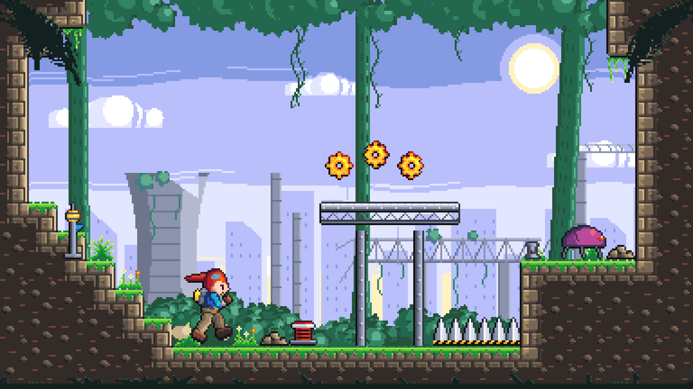

# A detailed asset set for a platformer

This file is for the maintainers and the agents working on this repo. It is not published (`package.json` `files` leaves `genres/` out). It is the second test of the [`ritmo-pixel-art`](../skills/ritmo-pixel-art/SKILL.md) skill and `ritmo-tools` on a platformer, after [`PLATFORMER-ASSETS.md`](PLATFORMER-ASSETS.md): the same kind of asset list at a larger scale, with Metal Slug as the reference for proportion, detail density, shading, and how lively the motion is. Every asset is original; no Metal Slug sprite, character, or palette is copied.



## Decisions

| | Choice | Why |
| --- | --- | --- |
| Screen | 384×216 art pixels: 5× on 1080p, 10× on 4K | 16:9 with a whole-number scale on the common screens. Metal Slug's 304×224 is about 4:3. 384 is 1.2× set one's width, so the larger sprites still leave a wide view: 24×13.5 tiles. |
| Tile | 16×16 | Double set one's. A block, a rivet, a crack, and a grass blade can each be a cluster, not a single pixel. |
| Player | 48×48 frames. The figure is about 40 px tall (2.5 tiles). The soles are on row 46 and the outline on row 47. Hitbox 12×34 (x 17..28, y 13..46). | Metal Slug's infantry is about 40 px. The head is about a third of the height, chunky as in Metal Slug, so the face, the goggles, and the hands read. |
| Palette | 60 colors of AAP-64 (`palette.hex`). The ramps are sky, steel, teal (backdrop growth only), leaf (play-layer grass), earth, stone, rose (skin), blue (the player's jacket only), fire (hair, warning paint), gold (cog, dash cell, beacon), and violet (the enemy only). The limit is 32 colors per asset (`pixel.config.json`). The player uses 30–31. | A bigger sprite needs longer ramps. AAP-64 has five or six steps of brown, khaki, green, teal, and grey, where Endesga 32 has three or four. Each material gets a contour, a shade, a base, a light, and a highlight. |
| Light | The sun, high on the right, ahead of the player | The player faces right and runs right, so her face and front are lit. A sprite flipped to face left takes its light with it; that is the usual compromise, and it is accepted here. |
| Outlines | Selective (sel-out): ink on the side away from the sun, and the material's own darkest step on the lit side (`selout` in `make.py`). Parts that overlap inside a sprite get a contour in the front part's darkest step. Terrain is outlined only on open sides. Backdrop planes have no outlines. The foreground is a flat dark teal with one rim of light. | This is how Metal Slug keeps a hard edge without a black cut-out look. An outline still means "in play" (direction research). |
| Detail budget | Clusters of 2 px or more. Every material gets one detail type: block bevels, pits and cracks in stone, rivets and a truss in steel, bark grooves in trunks, plate seams in the shell. Large masses rest: deep terrain turns into dark earth with a few buried stones. | Metal Slug's density, not its micro-detail. The skill says a crack is a cluster, like a fold in a cloak. |
| Read order | Spikes are the brightest value (white steel on gold-and-ink warning paint). The player is the only blue, and her hair is the strongest red. The cog and the dash cell share the gold. The enemy is the only violet. Terrain has lit rims where it is touched. The backdrop moves toward the sky's lavender. | The skill's read order and the contrast ladder from the direction research. |
| Dash signal | The cell on the backpack glows gold while a dash is ready and turns grey once it is spent (`player-spent.png`). | One look per meaning, on the player's own silhouette. It is not set one's scarf color, so the two sets stay distinct. |
| Parallax | Sky 0, far city 0.15, mid ruins 0.35, near jungle 0.6, play 1, foreground 1.3 (`PARALLAX` in `make.py`). | Plane speed follows depth. |

## The player: a posed puppet

Set one typed every frame by hand, and its weak spot was stiffness. Here the player is a puppet. Each limb is a tapered capsule between joints, posed by angles, so limb lengths never change from frame to frame. Each limb is shaded in bands along its length, from the one light. The jacket, belt, and trousers are drawn in the torso's own frame, so the torso can lean. The head is drawn by hand. Each frame gets one outline at the end. A pose is a few numbers (`RUN_LEG`, `air_poses`, ...). Standing poses are moved onto the ground row by measuring their pixels, and the wall-slide poses are moved so the hand and boot touch the wall. The animations:

- idle: 6×160 ms of breathing, with one blink;
- run: 8×70 ms (contact, down, pass, up, and the same for the other leg), with the arms swinging against the legs and the ponytail lagging a beat behind;
- jump: 3×80 ms (push-off, rise, tuck), then held;
- fall: 2×110 ms with the legs reaching down and the arms flailing up;
- dash: 3×50 ms (wind-up, then flat behind a thrown fist);
- wall-slide: 2×120 ms;
- land: 2×70 ms (squash, recover).

## Files (`platformer-assets-detailed/`)

- `make.py`: draws everything from code and palette names (Python 3 with Pillow). The same run makes the same bytes. `python3 make.py debug|tiles|props|bg` writes quick contact sheets to `/tmp` while iterating.
- `art/backdrop/bg-0-sky.png` … `bg-3-near.png`: the sky with the sun and clouds, a far ruined skyline, mid industrial ruins (a cooling tower, chimneys, a broken truss bridge, a crane), and near jungle (trunks, canopy, vines, a bush ridge). Each plane is 384×216 and loops.
- `art/foreground/fg-jungle.png`: palm fronds in the top corners and ferns along the bottom. It loops.
- `art/tiles/tileset.png` and `.json`: the 47-tile blob autotile plus 3 fill variants (a crack, a chip, moss), with the same JSON format as set one. Then a steel catwalk (left, middle, right, post), spikes facing 4 ways, and decoration (fern, flowers, rubble, vine, pipe).
- `art/player/player.png` and `.json`: the hash format plus `timing`, as in set one. `player-spent.png` is the same sheet with the dash spent. `player-idle.png` is the stand-in for `fx`.
- `art/props/`: `cog` (8 frames of spin), `spring` (rest, pressed, thrown), `beacon` (the checkpoint: off, then on with a blink), and `enemy` (a scrap beetle, 4 idle frames). Each comes with JSON.
- `fx/detailed.fx.json` and `fx/drafts/`: dash (a ring, or speed lines; the speed lines are in use), dust (puffs in use, or a skid), and collect. They are rendered to `art/fx/`.
- `art/mockup/mockup.png`: one room with every layer stacked. Previews are in `previews/`. `previews/compare/players@6x.png` shows set one's player above this one at the same zoom, and `mockups@3x.png` shows the two rooms side by side at the same pixel size. `previews/player/player-animations@3x.gif` plays every animation. `previews/parallax/parallax@2x.gif` (about 2.6 MB) is regenerated and gitignored.

## Regenerate

From `packages/core/genres/platformer-assets-detailed/`, with the repo's `pnpm install` done:

```sh
rt() { node "$(git rev-parse --show-toplevel)/packages/tools/bin/ritmo-tools.mjs" "$@"; }
python3 make.py                                    # the art, the stand-in, and the palette
(cd fx && rt fx check detailed.fx.json && rt fx render detailed.fx.json -o ../art/fx)
python3 make.py                                    # again, so the mockup reads the effects
for f in $(find art -name '*.png'); do rt pixel lint $f; done
```

## What changed with scale (against set one)

- **Proportion:** set one's climber is a head on legs, 1.5 tiles tall, with 1-pixel eyes. This player is 2.5 tiles tall, with a torso, separate arms, a ponytail, a backpack, goggles, and gloves. Silhouettes now carry pose: arm swing, a knee drive, a reach.
- **Motion:** at 16 px a pose is a few moved pixels, so jump and fall barely differed. At 48 px each animation has distinct key poses, and the hair gives secondary motion.
- **Shading:** a material went from 3–4 tones to 5–6, with contours between overlapping parts and a selective outline instead of a uniform ink one.
- **Tiles:** an 8 px tile holds a texture. A 16 px tile holds objects: cut blocks with bevels, cracks, chips, and rivets. The terrain needed a resting area (the dark earth inside) so masses do not turn to noise.
- **What stayed:** one palette, one light, outlines by plane, the read order, the blob autotile, the frame JSON, and the fx path.

## What is weak

- The player's hands cover the lower face in the wall slide and in the jump's reach. The far arm is almost always hidden, so the run's arm swing reads mostly from the near arm. The run's passing frames are narrow. A person should redraw the head for the dash (it stays upright while the body tips) and add in-betweens for jump-to-fall.
- The torso's cyan rim (`blue3`) reads as a stripe in some frames.
- The terrain's block facing is regular: two block patterns, repeated on every edge tile. Long walls show the repeat. The buried stones still read as dots at 1×.
- The backdrop's foliage is built from shaded circles. The canopy and the ridge read as piles of balls more than as leaves. Clouds are plain. The cooling tower's broken rim is crude.
- The spring is a red drum more than a coil. The beetle's legs are single-pixel lines and thin against its shell.
- `fx check` reports `teal0` (#122020) and `earth0` (#221c1a) as near-duplicates. Both are AAP-64 colors, kept apart by where they are used.
- No asset has been judged on a phone or in motion inside a running game.
