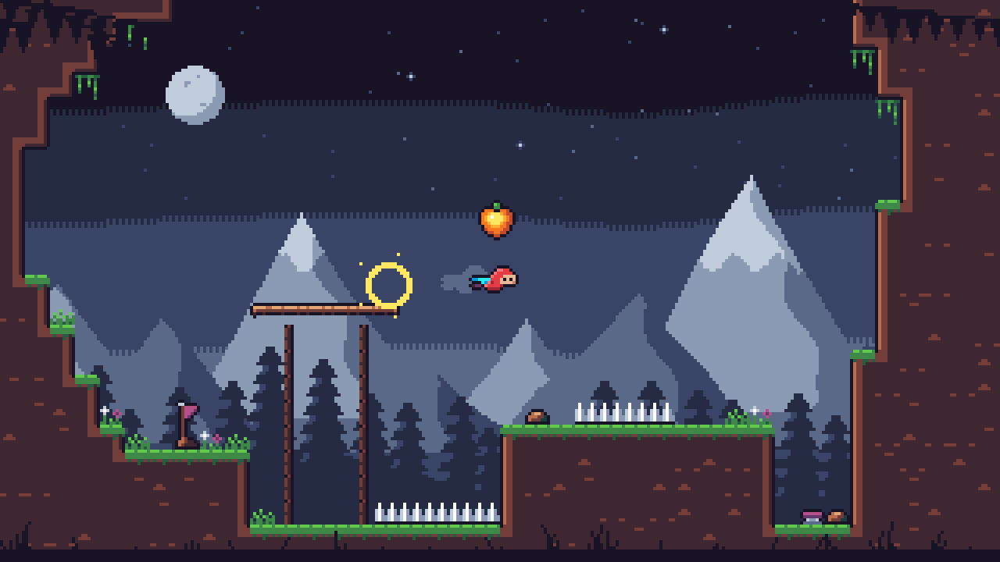

# A first asset set for a Celeste-like platformer

This file is for the maintainers and the agents working on this repo. It is not published (`package.json` `files` leaves `genres/` out). It is a test of what the [`ritmo-pixel-art`](../skills/ritmo-pixel-art/SKILL.md) skill, the art-direction research (`PIXEL-ART-DIRECTION.md`, `PIXEL-ART-EFFECTS.md`, `PLATFORMER.md` on their branches), and `ritmo-tools` produce for a platformer. Every asset is original. Celeste is the reference for scale, proportion, and grid only.



## Decisions

| | Choice | Why |
| --- | --- | --- |
| Screen | 320×180 art pixels, scaled by a whole number (6× on 1080p, 12× on 4K) | Celeste's size (Berry, quoted in `PIXEL-ART.md`). It is 16:9, and at 8 px tiles it shows a 40×22.5-tile room on one screen, so the whole challenge is visible (`PLATFORMER.md`, "the camera shows what is coming"). |
| Tile | 8×8 | Celeste's tile. The smallest detail that must read is the player's eyes, one pixel each. At 8 px tiles a 16 px hero is two tiles tall. |
| Player | 16×16 frames. The body is about 10×12 with the outline, and the feet are on the bottom row. Hitbox 8×12. | About 1.5 tiles tall, as in Celeste. The head is half the body (Schlitter: "a third to half" at small sizes), so the face reads. |
| Palette | 28 colors of Endesga 32 (`platformer-assets/palette.hex`), in 6 ramps: night (sky and every backdrop plane), earth (ground), moss (grass), coat (the player only), glow (the scarf, the fruit, the dash), and steel/violet (spikes, spring, flag). Each asset uses 16 colors or fewer (`pixel.config.json`). | The skill says to start from an existing palette. The ramps shift hue: the night ramp runs from violet-black to blue-white, and the earth ramp from plum to sand. The cold sky against the warm ground keeps the play layer apart from the backdrop. |
| Light | One moon at the upper left. Every asset is lit on its left and top and shaded on its right and below. | The skill's "one light". |
| Outlines | Things in the play layer (terrain edges, the player, props, spikes) have a 1 px `ink` outline on open sides. The outline goes on the 4 sides only, so corners come out round. Backdrop planes have no outlines. The foreground is flat `ink`. | Direction research, "Outlines by plane": an outline means "this is in play". |
| Read order | Spikes are the brightest value (white/haze on ink). The player is the most saturated thing and the only red. The fruit carries the glow ramp. Terrain is dark inside with lit rims where the player touches it. The backdrop recedes toward the haze, and each plane further back has less contrast. | Skill "What the player must notice is read first"; Dead Cells's contrast ladder (direction research). |
| Dash signal | The scarf is gold while a dash is ready and blue once it is spent (`player-spent.png` is the same sheet with the scarf recolored). | One look per meaning. The scarf belongs to the player, as Celeste's hair does. |
| Parallax | Sky 0, far 0.1, mid 0.25, near 0.5, play 1, foreground 1.25 (`PARALLAX` in `make.py`). Each plane's offset is rounded on its own. | Plane speed follows depth (direction research). Whole-pixel offsets (skill). |

## Files (`platformer-assets/`)

- `make.py`: draws everything below from code and palette names (Python 3 with Pillow). The same run always makes the same bytes.
- `palette.hex`, `pixel.config.json`: the palette and the project's rules, written by `make.py`. `ritmo-tools` reads them.
- `art/backdrop/bg-0-sky.png` … `bg-3-near.png`: four 320×180 planes. Each one loops horizontally, because every wave in it has a whole number of cycles across 320.
- `art/foreground/fg-grass-boughs.png`: grass along the bottom 12 px and pine boughs at the top corners, which are margins the player cannot reach. It loops.
- `art/tiles/tileset.png` and `.json`: the 47-tile blob autotile for terrain. `byMask` maps an 8-neighbour mask to a tile, and 3 more fill variants follow the 47. After the terrain come a one-way plank (left, middle, right, post), spikes facing 4 ways, and decoration (tuft, flowers, rock, vine).
- `art/player/player.png` and `.json`: idle 4×220 ms, run 6×70, jump 2×90, fall 2×90, dash 2×60, wall-slide 2×120, land 1×80. The JSON uses the hash format that Pixi, Phaser, and Aseprite read, plus `timing` (ms per frame and loop for each animation). `player-spent.png` is the same sheet with the dash spent. `player-idle.png` is the stand-in for `fx`.
- `props/*.sprite.txt` → `art/props/*.png`: the lantern fruit (the collectible), a spring at rest and thrown, and a checkpoint pennant.
- `fx/platformer.fx.json` and `fx/drafts/`: an effects bank with dash (2 drafts), dust (2), and collect (1). The drafts in use are rendered to `art/fx/*.png`, `.json`, and `.gif`.
- `art/mockup/mockup.png`: one room with every layer stacked as in the game. Previews are in `previews/`: 4× or 8× nearest-neighbour, with sprites on the sky's dusk, plus `player-animations@4x.gif`. `previews/parallax/parallax@2x.gif` (about 0.6 MB) is regenerated and gitignored.

## Regenerate

From `packages/core/genres/platformer-assets/`, with the repo's `pnpm install` done:

```sh
rt() { node "$(git rev-parse --show-toplevel)/packages/tools/bin/ritmo-tools.mjs" "$@"; }
for n in fruit spring spring-up checkpoint; do rt pixel render props/$n.sprite.txt -o /tmp/props/$n; cp /tmp/props/$n.png art/props/; done
(cd fx && rt fx check platformer.fx.json && rt fx render platformer.fx.json -o ../art/fx)
python3 make.py                                  # everything else, the mockup and the GIFs last
for f in $(find art -name '*.png'); do rt pixel lint $f; done
```

The props and the effects come first, because the mockup reads them. `fx review platformer.fx.json` opens the drafts for a person to pick and comment on. No draft is approved yet.

## What is weak

- The player has a readable silhouette and accent, but the poses are stiff. Jump differs from fall by little more than the scarf. In wall-slide, the hand on the wall reads as a nose. Dash reads as a red bullet. Run has 6 frames and no arm swing. A person should redraw the key poses.
- The terrain interior is a flat dark plum with sparse stones. It is quiet as intended, but large rock masses look empty. The grass drip pixels count as lone pixels for `pixel lint`.
- The mountains are clean facets from code. They have no rock detail and their snow lines are regular. The 2-row checker between sky bands shows as a comb at 4×.
- The spring and the checkpoint are small and plain. The fruit is the strongest prop.
- Nothing has been judged on a phone, or in motion inside a running game. The mockup is a still composite, and the afterimages in it are an engine effect drawn by hand.
